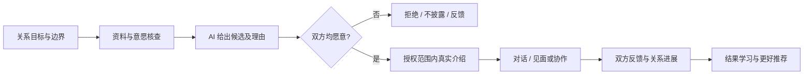

# LOKFEEL V23 | AI 原生关系与生成式社交平台 — 战略总目标与产品 PRD

版本：V23.0 | 日期：2026-11-16 | 状态：**OWNER_REVIEW_REQUIRED / 非自动批准**

> 来源：2026-09-07《Lokfeel 正反方辩论阶段性统一结论》、V21《02_PRODUCT_PRD.md》、2026-11-16《STRATEGY_LOCK.md》《V22_ACCEPTANCE_MATRIX.md》《W02_LIVE_AUDIT.md》。本稿是对历史战略冲突的合并建议，不伪称历史已签字。开发前应冻结这一版本的业务决策；无关 P0 安全、取证工作可先执行。

## 0. 重大纠偏与事实层级

V22 的“一个数字目标→通用任务执行→回归生活”不是 LokFeel 的产品类别，只是可复用技术方法。它把 Relationship Graph、双向选择、真实介绍、社交对话、信任与线下关系结果从主角降为附属场景；故 V22 战略定义**作废为拟执行版本**，保留其安全、体验、前端和发布治理证据，禁止据其做产品成功验收。

历史存在两条有来源的产品定义：
1. 2026-09-07：Verified Relationship Introduction Platform（以婚恋/值得见面的关系介绍为首个业务验证场景）。首要单位 `Verified Introduction`，不是普通 Match。服务闭环为身份/意愿/预期/吸引力/见面准备确认→双向接受→介绍→安全见面→反馈→关系进展；AI 负责筛选、排序、风险与 Copilot，人工负责复核、质控与高价值介绍。定价仅为测试假设。
2. V21：以真实社群关系与同意为核心的生成式协作操作台，Intent→WorkspaceSpec→任务→同意→行动→证据。此处 Agent、Mission、WorkspaceSpec 只能成为关系活动的执行底座，不能成为对外一级产品。

**统一后的 V23 判断（待 Owner 签字）**：共同的“可信真实连接”内核支撑消费端关系产品与社群运营者 SaaS；商业验证先聚焦经验证的真实介绍，不同时建设通用任务 OS、全功能 Dating App 与企业自动化平台。

## 1. 使命、品类、价值单位

**使命**：让更值得建立的真实关系发生，并让人少花时间在无效社交、低信任介绍和无结果互动上。

**品类**：AI-Native Relationship & Generative Social Platform（AI 原生关系与生成式社交平台）。

**中文一句话**：LokFeel 用 AI 理解你想建立的关系，在双方同意与安全边界内，帮你发现、介绍并推进值得连接的真实的人。

**英文测试文案**：Meet people worth knowing—with clearer intent, mutual consent, and real follow-through.

**最小价值单位**：`Verified Introduction`：不是让两人出现在匹配列表，而是具有可审计的资格核对、双方意愿、授权范围和实际引荐证据的一次介绍。`Verified` 具体指“满足已声明的介绍验证标准”，不等于身份完全可靠、背景调查通过、关系一定成功。

**北极星**：每 100 名合格参与者产生的、满足流程标准的有效真实介绍数量及其后续双方确认的会面/关系进展，分母、窗口与缺失数据必须公开定义。商业长期关注 `Verified Date Rate`、`Second Date Rate`、`30/90-Day Relationship Continuation`、`Outcome per Matchmaker Hour`；社群 SaaS 采用 `Mutually Accepted Introductions`、`Meeting/Collaboration Follow-through`，不得将约会指标混入专业社群业务。

### 反目标（禁止重新偏航）
- 不做通用“你想干什么我都帮你完成”的 Agent OS。
- 不把 WorkspaceSpec/Agent/Mission/MCP/A2A/Token 作为消费者的购买理由或首页主操作。
- 不做刷不完的配对卡、机器人冒充真人、虚假活跃人数和没有双方同意的自动私信。
- 不做未经验证的爱情寿命预测、灵魂伴侣分数、性格决定论；不因 AI 推断敏感属性而给用户打隐性标签。
- 不让一个 UI 同时面向婚恋消费者、社群管理员、开发者和 Hlua 会员。
- 不以 AI 站内回执、数据库行、绿色勾来冒充介绍送达、约会发生或关系成功。

## 2. 一套关系引擎 + 两种面向市场的产品

### A. LokFeel Relationship（B2C / 服务辅助）
**用户**：明确需要提升关系介绍质量、减少低效社交的真人；关系类型 V1 先针对有双向介绍需求的成人用户，在婚恋/长期关系场景验证，不对其他类型套用婚恋标准。

**要完成的工作**：以最少必要资料表达目标→证明真人与基本意愿→获得少量高质量、解释充分的候选→双向认可→安全介绍→沟通/见面→结果反馈。

**核心承诺**：减少错误投入，不承诺保恋爱、不承诺每个人都一定匹配；向用户清晰解释未推荐/不适合/尚无库存。

**产品路线**：申请/建档与可选人工复核→Verified Introduction→对话与双向安全安排→反馈。已有 `/dashboard/*` 交友资产以事实评估可复用程度，保留安全与权限逻辑；不直接把旧会员定价或老用户数据库当做新业务成功样本。

### B. LokFeel Social SaaS（B2B / B2B2C）
**用户**：专业社群、会员组织、人工红娘/顾问团队、活动组织者等需要“可信引荐 + 关系后续进展”的运营主体。

**要完成的工作**：收集有同意的人和介绍意图→管理员/顾问筛选→AI 建议候选与双方价值→分级披露→双向同意→真实引荐→跟进/反馈→衡量效果与人工成本。

**首个 SaaS 试点**：只允许选择**一个**与 B2C 引荐同构的高信任社群/顾问团队做试点，不新增一套完全不同的企业任务 SaaS。社群、会员数据必须隔离且可撤回授权。

### C. 共用基础设施（内部，不作为对外首页导航）
Identity & Verification、RelationshipIntent、ConsentPolicy、RelationshipGraph、Candidate Retrieval、AI Screening & Ranking、Introduction Workflow、Conversation & Follow-up、Safety & Moderation、Outcome Evidence、Billing/Ledger、Audit / Observability。

工作分工：`lokfeel.com` 的公开叙事应以真实连接价值为主；用户工作区展示“发现 / 介绍 / 消息 / 进展”；企业 Console 展示“成员 / 介绍队列 / 审核 / 进展 / 绩效”。既有 `Now/Studio/Field/Consent/Outcomes/Agents/Missions` 深链接可维护兼容，但不得成为新用户主导航。

## 3. 四类用户与具体 Job Stories

**U1 关系寻求者**：我希望结识与自己目标相近、愿意真实交流的人，而不是无休止刷匹配；我需要知道为什么推荐、哪些信息是真实核验、何时才会共享个人资料。

**U2 被介绍对象**：有人希望联系我，我希望先看到必要且被授权的信息、能接受或拒绝，拒绝后不受骚扰。

**U3 引荐者 / 关系顾问**：我管理若干真实候选，希望 AI 先筛掉明显冲突、生成可审核的介绍内容，让我用更少时间完成高质量双向引荐。

**U4 社群管理员**：我希望看到会员的真实互动进展、同意状态和投诉风险，而不是下载大量未经许可的成员资料或只看虚荣互动量。

## 4. 用户端最小闭环（P0）

用户首屏（首次访问）仅 1 个主动作：**告诉 LokFeel 你想结识什么样的人 / 建立什么关系**。已登录用户主动作：**查看下一次值得回应的真实连接**。没有真人供给时明确告知“目前没有符合双方条件的人”，不得生成假卡片填屏。

**五个必要最小流程**：
1. Relationship Intent：目的、边界、优先需求、不可接受项；渐进式提问，不要几十道问卷。
2. Trust & Profile：账户/身份/关系意愿的证据等级明确区分；无凭据不得 `verified`。
3. Connection Discovery：展示少量候选、适配原因与关键冲突，不展示未经授权的隐私。
4. Mutual Intro：双向明确同意，介绍送达后有真实系统或人工确认。撤销与举报须改变后续发送权限。
5. Follow-through：聊天/会面/结果反馈；“发送”“送达”“已读”“双方确认”“会面完成”分别取证，不合并为“成功”。

## 5. 生成式 AI 的正确职责

### 必须优先的五项 AI 能力
1. **关系意图抽取**：自然语言→结构化 `RelationshipIntent`，显示来源和可编辑字段；敏感场景追问，不随意补全意愿。
2. **候选筛选与解释**：显式硬性条件先过滤，软性条件只排序；输出适配依据、冲突、数据不足。AI 推荐不是客观相容性科学定论。
3. **安全审查辅助**：检测诈骗话术、异常/矛盾资料与骚扰迹象，安全标记供人工审核；避免仅凭敏感人口特征否决真人。
4. **引荐与沟通生成**：根据**双方允许披露**的资料生成个性化介绍/破冰/后续建议。人工或用户审批后才能发送。
5. **关系进展辅助**：根据双方自愿反馈给出下一步建议，学习关系中哪些条件和沟通方式有效；不得用模型对个人感情做未经验证的“成功预测”。

### AI 状态与成功判据
`MODEL_PROPOSED` 仅表示建议已生成；`HUMAN_APPROVED` 表示相应主体同意；`INTRO_SENT` 必须有真实发送记录；`INTRO_ACKNOWLEDGED` 表示接收方确认；`MEETING_COMPLETED` 必须有参与者反馈；`OUTCOME_REPORTED` 是自报结果；`OUTCOME_VERIFIED` 只针对有明确验证规则与证据的字段成立。

`AI 模型可用`、`工作区编译成功`、`AgentRun.status=EXECUTED`、`RECEIPT/IN_APP` 均**不等于**引荐、对话、见面、关系成功。

## 6. 风险、信任、隐私与治理

- 数据最少化 + 三层：可公开、需单次/双向授权、限制级核验资料（只用于核验）。不因加入 B2B 社群而默认可供婚恋匹配或反向共享。
- **Consent 双向且按字段/目的/期限/接收对象**；每次发送前服务端复核，撤回后不得新增披露，历史合法已发信息记录处置边界。
- 引荐必须有双方独立选择；拒绝不产生“自动重试骚扰”；真实身份状态不得虚构。
- 年龄适用性与未成年人保护、举报/拉黑/骚扰、线下安全和紧急处理须优先；V1 成人关系场景需年龄门禁。
- 不合规抓取私人社交资料、不自动向外部联系人发未经批准的推荐、不泄露跨租户关系图。
- 法律主体、服务条款、付费价格、身份验证标准、安全承诺须经相应审核；旧 B2C/Hlua 服务完全隔离，用户可理解所买服务。

## 7. 商业逻辑与验证路径

**不能同时用四套定价投放。** 历史辩论中的 `$49–99 Relationship Assessment`、`$199–399/次 Verified Introduction`、`$999–1,999/月 Membership` 均为**实验假设，不是已批准当前报价**。SaaS 端可按活跃服务成员、团队席位和已核验有效引荐设实验模型，但必须通过顾客访谈与毛利测算，不与消费者订阅/历史 Hlua 混卖。

**可证伪的 MVP 试点建议**：访谈 20 名明确有引荐需求的目标用户、10 名潜在双向参与者、3 家潜在 SaaS 组织；获得最少 10 次**真正双向同意**的介绍样本，再测介绍接受、交流、会面或协作和后续反馈。样本量是试点执行目标，不是市场需求已成立的统计结论。先检查真实合格供给密度，不能只有需求无候选。

**变现的四个硬问题**：用户愿为“减少无效社交/更可靠介绍”付多少；单位高质量介绍耗费多少人工与模型成本；供需能否在一个城市或社群内形成密度；相比人工/规则基线，AI 是否提高质量或产出/人工小时。任何未取得真实支付证据的实验不得宣称收入验证成功。

## 8. 指标与事件口径（不得以虚荣指标代替）

| 指标 | 精确定义（需在事件契约中落地） |
|---|---|
| Qualified Participants | 完成相应资格/意愿验证且同意参与的独立真人数，排除测试/机器人/重复账号 |
| Qualified Supply Coverage | 至少具有一个满足硬条件且可在授权范围内被联系候选的有效意图比例 |
| Mutual Intro Acceptance Rate | `双方同意次数 / 合法向双方发出的引荐提案数`，分母不得为空并区分超时 |
| Verified Introduction Rate | `完成协议定义的引荐确认次数 / 合格参与者数`，明确时间窗 |
| First Meeting / Conversation Rate | `双方确认会面或有效交流次数 / 双方同意且已完成引荐数` |
| Second Date / Follow-up | 仅婚恋垂类，以双方自报与可验证证据分级，不强迫披露私密结果 |
| 30/90-Day Continuation | 自愿随访；报告缺失率与存活偏差，不能把未回复当失败或成功 |
| Safety Incidents | 投诉/骚扰/疑似诈骗/隐私越权事件，按用户与接触次数归一化 |
| Outcome per Matchmaker Hour | 满足标准的介绍/进展数量除以人工有效工时，并与纯人工基线比较 |
| AI Value Add | 同等质量、用户结构和人工工时条件下，AI+人工相对人工/规则的增量，须真实 A/B 或准实验 |

## 9. 产品排序与退出条件

**V23 P0（最小可验证关系闭环）**：真实个人/社群关系档案、关系目标、适配候选、双方授权、引荐送达、对话/跟进、关系反馈、投诉与计量证据。

**V23 P1（有限 SaaS 试点）**：运营者名单、审查队列、双向邀约、顾问工作台、供需密度看板、收费实验。

**V23 P2（经结果证明后）**：跨社群关系图、更多社交场景、多模态、自动化外部联络、AI 个性化学习。

**停止准则**：如果有效供给不足、双方接受极低、投诉明显、真人不愿付费或 AI 相对人工没有证据增益，不得靠扩大 Agent、改 UI 或新增场景掩盖问题。应收缩到单一供需池与更窄介绍标准。

## 10. 明确等待 Owner 但不阻止工程取证的决策

- V23 战略定位、首个细分场景与市场的正式批准；未批准不得对外称已确定上线承诺。
- 是否把历史高端婚恋 Verified Introduction 作为**首个付费 MVP**：本稿建议是；B2B 社群作为配对机制复用的第二试点，不与 V1 同时大规模推广。
- 真实核验标准与人工复核职责；数据保留、社群跨用途授权、年龄与线下安全策略。
- D1 定价、D8 法律主体与 Dodo 生产收费授权。
- V23 唯一 RC 的生产迁移与发布授权。
