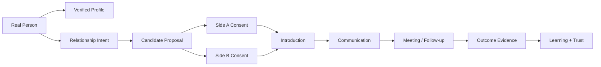
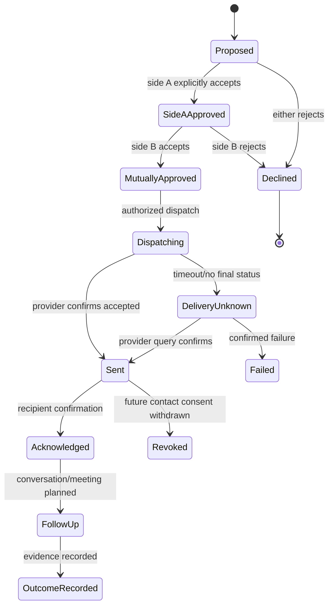

# LOKFEEL V23｜关系领域 Schema、API、算法、UI 与 QA 合同

**重要**：以下 TypeScript、API 路径、Prisma 实体是 **V23 拟开发契约**，不是对 `cad717e` 或本地 `6bab34c` 已上线能力的宣称。WorkBuddy 必须先跑代码资产盘点，优先映射已有 `User / Match / Chat / Connection / AgentRun / Mission / AgentApproval / ExecutionVerification / TenantAuditEvent` 等现有模型，避免重复建表、迁移失误与历史数据损失。

## 1. Domain model 的关系中心转向



**不可混用**：RelationshipIntent（想认识谁）≠ Mission（内部执行工作）；Introduction（双向同意之后的真实介绍）≠ Match（一种推荐）；OutcomeEvidence（关系实际进展证据）≠ ExecutionVerification（站内执行确认）。

### 建议 TypeScript 类型（可直接用于契约评审）

```ts
export type RelationshipContext =
  | 'ROMANTIC' | 'FRIENDSHIP' | 'PROFESSIONAL' | 'COMMUNITY';

export type VerificationLevel =
  | 'UNVERIFIED' | 'SELF_REPORTED' | 'IDENTITY_CHECKED' | 'MANUALLY_REVIEWED';
// 每个等级必须定义具体通过条件，不能依据名字暗示全套背景审核。

export interface RelationshipIntentV1 {
  id: string;
  actorId: string;                // 服务端从会话取得，客户端不可填权威身份
  context: RelationshipContext;
  goal: string;
  nonNegotiables: string[];       // 仅用户明确提供
  preferences: string[];
  locationScope?: string;         // 位置权限与精度另定义
  boundaries: string[];
  consentPolicyVersion: string;
  schemaVersion: '1.0';
  revision: number;
  createdAt: string;
}

export type IntroductionStatus =
  | 'PROPOSED' | 'SIDE_A_ACCEPTED' | 'SIDE_B_ACCEPTED'
  | 'MUTUALLY_ACCEPTED' | 'INTRO_DISPATCHING' | 'INTRO_SENT'
  | 'ACKNOWLEDGED' | 'DECLINED' | 'REVOKED' | 'EXPIRED'
  | 'REPORTED' | 'CLOSED';

export interface IntroductionV1 {
  id: string;
  context: RelationshipContext;
  proposerId: string;
  sideAUserId: string;
  sideBUserId: string;
  status: IntroductionStatus;
  approvalAId?: string;
  approvalBId?: string;
  disclosurePolicyVersion: string;
  allowedFieldKeys: string[];
  deliveryProvider?: string;
  providerMessageId?: string;     // 外部送达前不应产生虚假ID
  expectedNextAction?: string;
  createdAt: string;
}

export type EvidenceSource =
  | 'USER_SELF_REPORT' | 'COUNTERPARTY_CONFIRMATION'
  | 'PROVIDER_RECEIPT' | 'HUMAN_REVIEW' | 'SYSTEM_AUDIT';

export type OutcomeEvent =
  | 'INTRODUCTION_ACKNOWLEDGED' | 'CONVERSATION_STARTED'
  | 'MEETING_PLANNED' | 'MEETING_COMPLETED'
  | 'FOLLOW_UP_ACCEPTED' | 'RELATIONSHIP_CONTINUED'
  | 'INTRODUCTION_DECLINED' | 'SAFETY_REPORTED';

export interface RelationshipOutcomeEvidence {
  id: string;
  introductionId: string;
  event: OutcomeEvent;
  source: EvidenceSource;
  subjectUserId?: string;
  evidenceRef: string;            // 内部可追溯引用，公开不可暴露原始PII
  recordedAt: string;
  verificationRuleId?: string;
  status: 'REPORTED' | 'CONFIRMED' | 'DISPUTED' | 'REVOKED';
}
```

### 关键数据安全不变量

1. 任意字段默认不可共享；只有该 `context + recipient + purpose + fieldKey + expiry` 的有效授权才可披露。
2. `status='INTRO_SENT'` 必须有真实投递事件；仅在系统内部创建 `Mission` 或 `AgentExecution` 不行。
3. `RelationshipOutcomeEvidence` 的 `CONFIRMED` 明确是哪一类事件及谁确认，不代表婚恋成功。
4. 每个强制状态变化都写审计事件及版本戳；重复 webhook、请求超时与撤销竞态不可产生副作用重复。
5. 任何新表 migration 与旧 B2C 数据表分离，先核对 user/org 边界、合法用途和历史兼容。

## 2. 拟 API 契约与现有接口复用顺序

**复用原则**：优先复用现有 `/api/v1/missions`、`/api/v1/agents/runs`、`/api/v1/connections/*`、`/api/v1/outcomes`、旧 `/dashboard/*` 认证与聊天端点；只有领域关系对象无法表达时才增加新端点。

| 功能 | 建议接口（必须资产审查后定） | 状态 | 强校验 |
|---|---|---|---|
| 关系意图 | `POST /api/v1/relationship-intents` | PROPOSED | 登录主体来自服务端；Schema；同体幂等；敏感字段单独授权 |
| 编辑意图 | `PATCH /api/v1/relationship-intents/:id` | PROPOSED | revision 乐观锁；不同租户403/404；已介绍不静默覆写历史 |
| 真实候选 | `GET /api/v1/relationship-candidates?intentId=...` | PROPOSED | 无库存返回合法空数组；不返回未同意的身份材料 |
| 创建介绍提案 | `POST /api/v1/introductions` | PROPOSED | 必须存在合法候选与可联系授权，策略引擎通过 |
| 双方决定 | `POST /api/v1/introductions/:id/decision` | PROPOSED | 服务器识别 Side A/B，禁止代表对方同意 |
| 介绍投递 | `POST /api/v1/introductions/:id/dispatch` | PROPOSED | 双方同意且未撤销；正式外部动作需审批；exactly-once effects via idempotency |
| 介绍明细 | `GET /api/v1/introductions/:id` | PROPOSED | 隐私投影视图按用户和权限分别返回 |
| 反馈 | `POST /api/v1/introductions/:id/outcomes` | PROPOSED | source/evidence/时间；不可自我夸大 VERIFIED |
| 风险举报 | `POST /api/v1/reports` | EXISTING / VERIFY | 复用现有安全体系，跨线隔离与拉黑生效 |
| SaaS 审核队列 | `GET /api/v1/org/introductions` | PROPOSED | 只有所属组织和权限可见；最少化数据 |

统一响应信封与当前 `/api/v1` 保持一致，**不得再次把 `data` 数组错读成 `data.items`**。必须在 API 契约中明确游标、错误、`0` 与 `null`、不可用与无数据的区别。

### 例：双向同意门禁（伪代码，需落在服务端事务中）

```ts
async function dispatchIntroduction(input: { introductionId: string; actor: SessionActor; idemKey: string }) {
  // 从服务端认证上下文确定 actorId / orgId；客户端传来的身份无权威性。
  const intro = await readScopedIntroduction(input.introductionId, input.actor);
  if (!intro) throw new NotFoundError();
  if (intro.status !== 'MUTUALLY_ACCEPTED') throw new ConflictError('MUTUAL_CONSENT_REQUIRED');
  if (!(await bothConsentStillValid(intro))) throw new ForbiddenError('CONSENT_REVOKED');
  if (await isBlockedEitherWay(intro)) throw new ForbiddenError('RELATIONSHIP_BLOCKED');
  // 原子持久化 outbox；先提交事务，worker 再投递；幂等键按关系+双方+意图+操作类型作用域。
  const outbox = await enqueueExactlyOnceByBusinessKey(intro, input.idemKey);
  return { status: 'QUEUED', introductionId: intro.id, outboxId: outbox.id };
}
```

## 3. 推荐模型：先排除硬冲突，再做可解释排序

**不要**用模型直接产生一个“灵魂契合 97%”数字。推荐排序只依据用户主动提供和有来源的资料：

- Step 1：验证对象是同一关系上下文、在服务范围内、允许被考虑、非拉黑、基本硬约束不冲突；缺失必需资料进入 `NEEDS_INFORMATION`，不默认通过。
- Step 2：候选以硬条件匹配、软条件适配、对方可参与程度、关系意图一致性和安全标志构造可解释依据。
- Step 3：权重只在有标注样本后优化。先实现可复跑规则基线，再比较 AI 候选排序。人工覆核和用户接受反馈不得只作训练标签，还必须允许争议/纠错。
- Step 4：离线衡量 precision@K、mutual acceptance、投诉率和有结果的有效介绍；没有 ground truth 则只报告未验证假设。

**禁止的捷径**：推断用户敏感身份、未经授权抓取社交平台、从照片推断人格/生育倾向/性取向、用用户未同意的上下文跨产品训练或推荐。

## 4. 引荐与结果状态机（业务事实优先）



重大风险：`Provider accepted` 不等于被介绍者已收到、阅读、接受或愿意见面；双方可随时撤回后续授权。支持业务补偿和对账，不用“系统重试成功”代替真人认可。

## 5. 测试要求：功能主链至少 3 类真实场景

| 场景 | 真实主体 | 核验目标 | 失败分支 |
|---|---|---|---|
| 成人关系介绍 | 2 个独立合规成人账号 + 人工/运营者（如需要） | 从意愿→双向同意→受控介绍→反馈 | 资格不足/单方拒绝/撤回/拉黑/供给为空 |
| 可信社群引荐 | 2 组织成员 + 组织运营者 | 双向允许资料披露和真实引荐 | 跨组织读取、社群成员退出、后台越权 |
| 个人关系维护 | 1 现有关联对象 + 双方已有许可 | AI建议破冰/跟进；用户批准后真实发送 | AI越权自动私信、无回执假成功、未授权共享 |

**所有自动化必须有现实双账号、账号来源与参与人许可；第三方真实联系须得到有效授权；沙箱真交互 ≠ 生产中已发生用户关系成果。**

### TDD 必须先变红的防伪断言（示例 Jest）

```ts
describe('relationship trust invariant', () => {
  it('cannot introduce without both parties opt-in', async () => {
    const r = await attemptDispatch({ sideA: true, sideB: false });
    expect(r.status).toBe(403);
    expect(await getOutboxCount()).toBe(0);
  });
  it('does not mark meeting completed on a provider SENT event', async () => {
    await acceptProviderReceipt('message-sent-001');
    expect(await getOutcomeState()).not.toBe('MEETING_COMPLETED');
  });
  it('never shows fictional candidates for zero-supply', async () => {
    const cards = await fetchCandidatesWithNoInventory();
    expect(cards).toEqual([]);
  });
});
```

## 6. UI/UX：用人话表达关系产品，而非技术层

**首页 IA**：Hero（关系价值 + 一个 CTA）→为什么值得信任（状态与标准说明）→三步工作方式→两个真实生活/社群情景（Demo 明示）→隐私/双方决定权→真实供给/服务范围边界→CTA；开发者接口只在 footer 的专门文档。

**消费端 IA**：`发现适合的人 / 我的介绍 / 消息 / 关系进展 / 安全与设置`；视角色和授权显示具体功能。空列表说明真实库存不足和下一步；不以假数据填屏。

**组织 SaaS IA**：`介绍队列 / 成员 / 审核与授权 / 跟进 / 效果 / 安全 / 设置`；首屏展示待审核真实人际连接，绝不展示四个工程阶段空计数。

**对现有七 key**： `now` → 我的连接概览；`studio` → 引荐方案编辑（高级）；`field` → 授权范围内的关系网络；`consent` → 等待双方确认；`outcomes` → 关系进展；`agents` → AI 顾问/审核记录（高级）；`missions` → 引荐与跟进事项（高级）。保留 URL 向后兼容；不让七个工程名字出现在新客侧边栏。

### 文案示例（供 Owner/用户测试裁决，不是已经获批）

- 英文 Hero：**Meet people worth knowing.** / *AI helps you find meaningful introductions, with clear intent, mutual consent, and room for real connections to grow.*
- 中文 Hero：**少一点无效社交，多一点值得认识的人。** / *AI 帮你理解关系需求、发现更合适的连接。介绍前，双方都有选择权。*
- 结果状态：`已为双方准备介绍 / 对方尚未同意 / 双方已同意 / 介绍已送达 / 等待交流反馈 / 双方反馈已收到`。
- 禁止主屏：`MISSION PIPELINE / COMPILER / INTENT_EXTRACTION / 5 MCP / 50 REST / Verified Outcome 27`。

## 7. 生产、支付与安全门禁（不得靠设计稿遮住）

1. 保持生产付费 Gate fail-closed；三份旧业务产品目录独立，D1 未批不出价。
2. `proxy.ts` 原冻结门不直接永久删除，但不能让四个关系介绍页永远只显示占位；采取“可被审计的内容状态 + 商业声明逐项解锁”方式，商业/法务缺口继续阻断相关承诺。
3. 真实 Dodo test-mode：订单→官方 webhook→账本→正确产品权益→异常/退款；无投递则 `NOT_TESTED`。
4. 保护 GitHub main；代码在独立 PR + required CI + Preview；绑定唯一不可变 tree SHA、Schema Migration 和安全回滚部署。
5. 性能沿用 G15 9 页 ×≥3 轮真实 Trace，TBT <=200ms、LCP <=2500ms、CLS <=0.1，不减试样、不改节流。
6. 10名真实目标用户：≥8/10 能准确说出“真实人与人关系/介绍”而不是“通用AI任务管理”；≥8/10 无指导完成“提交关系意图→阅读推荐→拒绝/接受介绍”核心动作。
7. 任意强制 gate 未通过，不得宣布 `RELEASED_AND_VERIFIED`。
